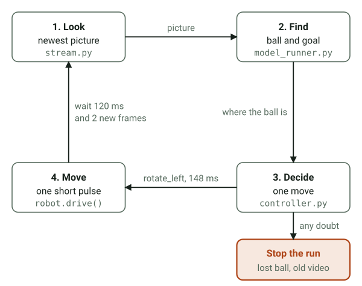
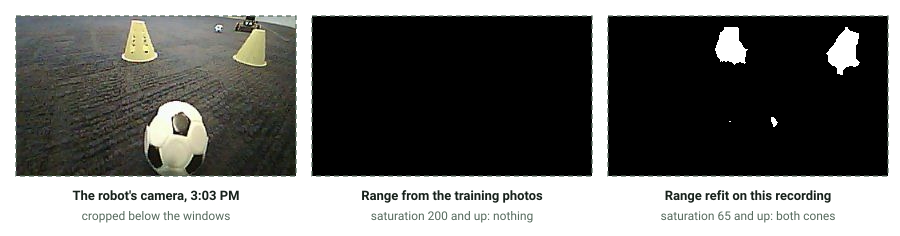

# Robocar: a ball-pushing robot car with on-device AI

A robot car that finds a soccer ball with a vision model running on the robot itself, drives up
to it and pushes it toward a goal made of two yellow cones, with no cloud and no one driving it.
It never saw the goal itself, so it started lined up with the gap between the cones and pushed
straight. I built its software alone, with Claude Code as my coding assistant, for the Robocar
track at Build Day with Qualcomm (October 24, 2026, Northeastern University Silicon Valley), on an
Arduino UNO Q. It took first place in the track, with a 7.12 s run.

| At a glance | |
|---|---|
| Robot | Arduino UNO Q on a Hiwonder miniAuto chassis, with an ESP32-S3 camera streaming over Wi-Fi |
| Team | Solo |
| Vision | An Edge Impulse FOMO model running on the board, 3 to 9 ms a picture when timed on five test pictures |
| Control | Python rules: one short timed move per fresh picture, every move 1 to 1000 ms |
| Result | First place in the Robocar track, with a 7.12 s run |
| Tests | 153, passing on Python 3.10 and 3.13 |

The kit set the hard parts. The camera's video shared one Wi-Fi channel with every other team's
camera, so pictures came slowly and unevenly. The motor firmware reads a move of 0 ms as "drive
forever", so every move had to be bounded. And the only training photos showed the field from
above, while the robot's camera sits low.

## The problem

The track asked one question, in the event page's words: "Which robocar can identify the goal and
score first?" Every team got the same kit, an event guide with starter code
([aaishikasb/uno-q-hackout](https://github.com/aaishikasb/uno-q-hackout), the organizers' repo),
and one day to make it drive itself; building ran from 10 AM to 4 PM, then the judges watched
runs. Code written beforehand was allowed (I asked at check-in), so the detector, the camera reader
and the decision logic were written and tested on a laptop in the two days before, against a fake
camera and a synthetic field video. The day itself went to the real robot: the two-cone goal code
once the field was known, training the model, tuning, and floor runs.

The field was gray carpet, a small white soccer ball with black spots that looks cream in the
room's light, and a goal made of two yellow cones with a gap between them. A few facts about the
kit shaped the design:

- The camera is a separate board with its own Wi-Fi network, streaming 320 by 240 MJPEG (a video
  made of separate JPEG pictures). Every kit's camera uses the same Wi-Fi channel, and about ten
  of them shared the room, the likely reason the video was slow and uneven: in the 17 runs whose
  app logs survive, the rate ran from 1.9 to 7.5 new pictures a second, with 2.9 in the middle
  run, and in one watch-only run the video stalled for 1.5 s or more about every 5 s.
- The motor firmware reads a move's duration of 0 as "drive forever".
- The board's Python runs inside the container of Arduino App Lab (the tool that builds and runs
  apps on the board), with Python 3.13, numpy and OpenCV already installed. The camera's network
  has no Internet, so the code uses numpy and OpenCV and nothing else.

## How I built it

The work went spec first. I approved a written design (`docs/SPEC.md`) before any code existed,
and Claude Code wrote the code and the tests against it, held to the rules in `CLAUDE.md`: Python
3.10 and up, numpy and OpenCV only, and no move longer than 1000 ms. My part was the decisions and
the robot: what to build and test before the day, what each floor run showed and which setting to
change next, training the model in Edge Impulse, and running, watching and debugging every run on
the real robot. The commit history keeps that trail, one small commit per step.

## How it works

The UNO Q holds two computers. The camera's video goes over Wi-Fi to the Linux side, a Qualcomm
chip, where the Python code finds the ball and picks a move. Bridge, Arduino's link between the
two, hands the move to the microcontroller, which runs the four mecanum wheels (wheels with angled
rollers, so the car can also slide sideways) and stops them on time. A BOOT button on the camera
starts and stops a run.


Each pass of the loop takes the newest picture, finds the ball and the goal, picks one move and
sends it as one pulse (a timed move, such as forward at speed 220 for 400 ms), then waits for new
pictures that show where the move left it. Any doubt, such as old video, a lost ball or an error,
stops the run.



The code is in `prep/`:

| File | What it does |
|---|---|
| `stream.py` | Reads the camera's stream on a background thread and keeps only the newest picture, so the robot never works through a backlog. It flags a stall when no new picture comes for 3 s or the same one repeats 5 times. |
| `model_runner.py` | Runs the trained Edge Impulse model, an `.eim` file that is itself a small Linux program, and talks to it over a socket with the standard library, numpy and OpenCV, and no Edge Impulse package. The ball is the model's most confident ball box; the goal is the midpoint of its two most confident cone boxes, and one cone alone counts as no goal. |
| `detector.py` | The backup finder: color ranges in HSV (hue, saturation and value, where saturation is how strong a color is) plus shape checks for a round ball and a pair of cones. `tune.py` sets the ranges with sliders on live or recorded video. |
| `controller.py` | The decision rules as pure logic, with no hardware and no clock: 14 rules checked in order, and every move comes back with a plain reason. |
| `runloop.py` | Look, decide, move, wait. It also has a watch-only mode that prints what the robot would do, and a mode that measures the camera's delay. |
| `robocar_main_template.py` | The event guide's starter `main.py`, wired to the files above: one run per BOOT press. |
| `robocar_config.json` | Every threshold, speed and timing the rules use, so tuning on the day never meant editing code. |

Each decision prints one line in the app's log, with what the camera saw and why the robot moved,
such as `FORWARD forward speed=220 ms=400: ball centered and far: approach`. Those lines are how
every run was read afterwards.

Safety lives in the same numbers. Every pulse is 1 to 1000 ms, checked when the settings load and
again before each move of a run is sent with `drive()` (the guide's function that hands one move to
the microcontroller), so a duration of 0 never goes out. The firmware's own timer ends each pulse
even if Python dies. That timer is checked in the motor sketch's main loop, though, so a stall
there would delay the stop, and on the day a stuck I2C bus (the two-wire link that also carries the
camera's button) was suspected of stalling it once. BOOT is a software stop as well, so the
motor-power switch stayed the real one. A run ends by itself after 45 s, after 8 pushes, or after 5
pictures in a row without the ball. Any error stops the motors and ends the run without crashing
the app, so the next BOOT press starts clean. From 4:32 PM a stopgap on the board also let a run
start from the laptop, through a file that a patched copy of the guide's `robot_client.py` watched
for; it never steered the robot, and the guide's file went back before the kit was returned.

The robot acts only on a picture that arrived at least 120 ms after its last move ended, and only
once at least 2 new pictures have come in, so a move came about every 1.5 s (the middle value over
163 moves in the 17 logged runs). It is built not to steer by a picture of where it used to be.
The stream carries no time for when a picture was taken, though, and the camera's delay was never
measured, so the rule goes by when each picture arrived.

### The model

Edge Impulse, a web service for training small models that run on devices, trained a FOMO
detector (MobileNetV2 0.35, 96 by 96 pixel input). FOMO, short for "Faster Objects, More
Objects", marks where each object's center sits on a coarse grid instead of drawing a box around
it. Position is all the rules need, and it is fast on the board: 3 to 9 ms a picture, timed
through `model_runner.py` on five of the organizers' pictures.

The organizers supplied 353 photos of the room, taken from above (281 for training, 72 for
testing), labelled `soccerball` and `goal`, with one box per cone. Before training, a check
downloaded every picture through Edge Impulse's public API, measured the color inside each box (the
cones are a strong yellow and the ball is not) and looked at each flagged picture by eye; it found
some labelling slips, such as cones labelled as the ball, which the organizers fixed in the
training pictures before this model was trained. Edge Impulse scored the model at an F1 of 96.9%
on the 57 training pictures it held back to check it (goal 98%, ball 96.4%), where F1 balances how
many of the model's detections were right against how many of the real objects it found. Those
photos come from the same set, taken from above, so the score says how well the model learned
them, not how it does on the robot's camera, and the 72 test pictures were not scored.
[docs/EDGE_IMPULSE.md](docs/EDGE_IMPULSE.md) has the settings and the check.

### Built and tested before the robot

`demo.py` runs the whole loop with pretend motors, on a video file or a webcam. `tools/` draws a
synthetic field video and holds a fake camera that serves it as a stream, plus a stand-in for the
Edge Impulse model, so the model runner was tested before a real model existed. Two notebooks,
[how the detector sees](prep/notebooks/01_how_the_detector_sees.ipynb) and
[how the robot decides](prep/notebooks/02_how_the_robot_decides.ipynb), walk the color finder and
the rules through the synthetic video step by step, and each checks itself against the real code;
GitHub shows them with their pictures. 153 tests pass on Python 3.10 and on 3.13, the board's
version, including a run of the starter template against the guide's real `robot_client.py` with
a fake Bridge, and both notebooks top to bottom.

## Results

The robot took first place in the Robocar track, with a 7.12 s run, the time reported at the
field. The app's log, read afterwards, holds the run that was most likely the judged one:

```text
[  0.08s] frame   914 | ball x=170 y=130 r=10 | goal   -- | FORWARD forward speed=220 ms=400: ball centered and far: approach
[  1.39s] frame   917 | ball x=170 y=130 r=10 | goal   -- | FORWARD forward speed=220 ms=400: ball centered and far: approach
[  2.91s] frame   919 | ball x=160 y=190 r=20 | goal   -- | FORWARD forward speed=180 ms=300: ball centered and near: slow approach
[  4.39s] frame   922 | ball x=180 y=200 r=20 | goal   -- | PUSH    forward speed=255 ms=550: ball close and centered, goal not in view: pushing as if lined up
[  5.89s] frame   924 | ball x=170 y=210 r=10 | goal   -- | PUSH    forward speed=255 ms=550: ball close and centered, goal not in view: pushing as if lined up
[  7.40s] frame   927 | ball x=190 y=170 r=10 | goal   -- | FORWARD forward speed=180 ms=300: ball centered and near: slow approach
[  8.85s] frame   930 | ball x=200 y=170 r=20 | goal   -- | FORWARD forward speed=180 ms=300: ball centered and near: slow approach
[ 10.35s] frame   934 | ball   --            | goal   -- | WAIT    ball not seen (1 of 5); holding still
[ 10.50s] frame   935 | ball   --            | goal   -- | WAIT    ball not seen (2 of 5); holding still
[ 10.59s] frame   936 | ball   --            | goal   -- | WAIT    ball not seen (3 of 5); holding still
[ 10.72s] frame   937 | ball   --            | goal   -- | WAIT    ball not seen (4 of 5); holding still
[ 10.85s] frame   938 | ball   --            | goal   -- | DONE    ball gone after 2 push(es): attempt finished
```

Two far moves (the full approach) and a near one (the slow approach close to the ball) brought it
to the ball, pushes came at 4.4 s and 5.9 s, and two more moves followed the ball as it rolled off
to the right, until it left the picture at 10.4 s. The log can't show the goal, and its clock
starts after the BOOT button's countdown of about 1.2 s, so it can't say when the goal came either.

The winning run used bigger moves, set at 4:51 PM: each forward move got double the speed for
double the time, and each push about 2.5 times the speed times the time, its speed reaching the
top value of 255. How far each move went was never measured. Bigger moves are faster and harder to
control. The first run with them lost the ball after 2 pushes, since each big move near the ball
made it drop out of view, while the best run at the old sizes drove to the ball and kept it
against the front for all 8 pushes, ending on its push limit at 23.1 s.

Over the day the robot made 24 floor runs, each in the [runs table](docs/CALIBRATION_LOG.md#runs)
with what it showed and what changed after it: 13 of them reached the ball and pushed it, and two
goals were recorded, one in the runs from 3:32 to 3:36 PM and the judged one. The
[day's log](docs/NOTES.md#the-days-log-oct-24) has the rest. The app was handed in at 3:45 PM,
before the 4:00 PM deadline, as a ZIP in the organizers' submissions repo
([pull request 8](https://github.com/aaishikasb/uno-q-hackout-submissions/pull/8)), and a check
right after showed that App Lab's own import accepts that same ZIP. The judged run came after the
hand-in, with two later changes: turning in place instead of sliding (4:06 PM) and the bigger
moves (4:51 PM).

## Limits, and what caused them

### The robot never saw the goal

The model missed the cones, and the color backup would have missed them too. So every push went
straight ahead "as if lined up", in the log's words, and the robot had to start lined up with the
gap.

The model learned the cones from the organizers' photos, taken from above, where each cone is a
round, deep-yellow disc. The robot's camera sits low and sees pale yellow triangles from the side.
On a recording with both cones in plain view, each about 30 px wide, the model returned the ball
and no cone box at all. The ball went through the same crop, resize and color packing in the same
pictures and was found, so the model's input path is not at fault, and size was ruled out too:
after the model's resize the cones are about 12 px wide, like its training cones. Two questions
stay open: whether the side view or the pale color mattered more, since the two were never tested
apart, and whether the cones scored just under the model's cut-off, which this `.eim` file gives
no way to lower.

The color backup's yellow range came from the same photos, where the cones measure saturation 245
on OpenCV's 0 to 255 scale, so it accepted 200 and up. On the robot's recording the cones measure
80 to 108. A range refit on that recording (hue 20 to 36, saturation from 65, brightness from 100)
found both cones in all 29 frames that show them and in none of the other 76 frames recorded that
day, which show no cones. It was fitted and checked on the same frames, so it is untested on new
footage. It came after the hand-in and never ran on the robot, and it needs a small code change as
well: with the model switched on, the color finder doesn't run at all. Here is one of those frames,
with what each color range picks out:



Both failures are domain shift: the pictures a model, or a hand-set threshold, meets in use differ
from the ones it was built from. The tests could not catch it. They check logic and safety on
drawn pictures, and the drawn Build Day scenes in the detector tests use the training photos'
cone color, saturation 245.

### A blind spot right in front

The camera can't see the ground right against the robot's front. In a ball-only run, after the
second push the ball stayed against the robot, below the bottom of the picture, and the rule "ball
gone after a push means finished" ended the run at 12.9 s with the ball still there. The planned fix
is a rule: when the ball vanishes right after a close, centered push, push again up to twice before
calling it gone.

### Sideways slides barely move it on carpet

Slides were meant to re-center the ball without turning away from the goal. On this carpet they
barely moved the robot: in one run, 12 slides in a row over 15 s never brought the ball back, and
it drifted from 50 to 90 px left of center until it was lost. At 4:06 PM steering switched to
turning in place, with a wider center band (the strip around the middle of the picture where the
ball counts as centered): 40 px either side instead of 24.

### App restarts sometimes silenced the motor chip

Five times during the day, restarting the app left the microcontroller silent: the first Bridge
call, `stop`, timed out after 10 s. Each time only a board reboot brought it back. Starting the app
with `--no-prepare`, which skips recompiling the motor code and resetting the chip, worked 4 times
out of 6. The root cause is still open. Separately, after a flat battery and a battery swap, the
chip couldn't read the BOOT button or the line sensor over I2C until another reboot.

### Smaller limits

The video set the pace: a move came about every 1.5 s. Balls far away near the top of the picture,
probably other teams', pulled the robot sideways in 4 of 5 runs in one stretch. The model sees only
the middle 240 of the camera's 320 columns. The pulse sizes were never measured in centimeters, and
the camera's delay was never measured with the latency mode.

## What I would do next

- Retrain the model on the robot's own pictures, with cones seen from the side in this camera's
  colors, and measure it on robot frames before and after, keeping whole recordings apart for
  testing rather than single frames: a small, real experiment on domain shift.
- Take the ball from the model and the goal from the refit color range, with the small code change
  that lets both finders run.
- Push again when the ball sits in the blind spot, instead of calling the run finished.
- Ignore far balls by taking the one lowest in the picture, which is the nearest.
- Use the big moves only while the ball is far.
- Measure the camera's delay with the latency mode, and find why restarts silence the motor chip.

## Run it

The laptop parts were tested on macOS; the model runner talks to the model over a Unix socket, so
they need macOS or Linux, with [uv](https://docs.astral.sh/uv/) (a Python project manager)
installed. Two of the tests need the organizers' guide cloned into `upstream/` at the repo root,
so from the repo root:

```bash
git clone https://github.com/aaishikasb/uno-q-hackout upstream
```

Without it those two are skipped. The other commands run from `prep/`. The tests, on the
project's Python 3.10:

```bash
uv run pytest
```

The same tests on Python 3.13, in a throwaway environment:

```bash
uv run --isolated --python 3.13 pytest
```

A dry run of the whole loop on a synthetic field video, then the color tuner on it:

```bash
uv run python tools/make_synthetic_video.py
```

```bash
uv run python demo.py --source samples/synthetic_field.avi
```

```bash
uv run python tune.py --source samples/synthetic_field.avi --loop
```

The synthetic video draws the field of the organizers' August event (a white goal on a green
floor), while the repo's settings are for Build Day's yellow cones, so the demo never sees a goal
on it; the tests and notebooks use August's color presets for this video. The tuner opens windows
with sliders, so it needs a desktop: `q` quits, and `s` saves that target's ranges into
`robocar_config.json`.

To run it on the robot, follow "How to run it" in [the hand-in README](docs/SUBMISSION_README.md).
The trained model is not in the repo, and [docs/EDGE_IMPULSE.md](docs/EDGE_IMPULSE.md) says how it
was trained. The repo's `robocar_config.json` starts on the color finder (`"detector": "color"`),
so the app starts without the model file; the judged runs used the model (`"detector": "model"`),
and that is the only difference from the settings on the board.

## Where things are

- `prep/`: the code, its tests, the notebooks and the laptop tools, as a uv project on Python 3.10.
- [docs/NOTES.md](docs/NOTES.md): the day's time-stamped log, then the reference notes for the
  board.
- [docs/CALIBRATION_LOG.md](docs/CALIBRATION_LOG.md): every floor run in one table.
- [docs/EDGE_IMPULSE.md](docs/EDGE_IMPULSE.md): the model that ran, its training and the label
  check.
- [docs/SPEC.md](docs/SPEC.md): the design: the constraints, the settings file, each module and the
  tests.
- [docs/SUBMISSION_README.md](docs/SUBMISSION_README.md): the README handed in with the app at
  3:45 PM.
- [docs/REPO_GUIDE.md](docs/REPO_GUIDE.md): a file-by-file guide to this repo and to the
  organizers' event guide, including what the guide's own docs leave out.
- Written before the event and kept as records: [docs/CHECKLIST.md](docs/CHECKLIST.md),
  [docs/QUESTIONS.md](docs/QUESTIONS.md), [docs/RUBRIC_PLAN.md](docs/RUBRIC_PLAN.md) and the
  hand-in template, [docs/SUBMISSION_README_TEMPLATE.md](docs/SUBMISSION_README_TEMPLATE.md).
- `CLAUDE.md`: the rules Claude Code followed in this repo.
- `figs/`: the diagrams and the robot-camera picture, as SVG files.

## Credits

The event guide and its starter code (the starter `main.py`, `robot_client.py`, the motor sketch
and the camera firmware): [aaishikasb/uno-q-hackout](https://github.com/aaishikasb/uno-q-hackout).
The guide states no license. `prep/robocar_main_template.py` adapts its `robocar/python/main.py`,
and the lines taken from it belong to the guide's authors, outside this repo's license.
`docs/NOTES.md`, `docs/REPO_GUIDE.md` and `docs/RUBRIC_PLAN.md` summarize the guide, its starter
code and its rubric, with the rubric's own words in quotation marks. The tests load the guide's
`robot_client.py` from a local clone and never copy it.

The Arduino UNO Q, App Lab and Bridge: Arduino. The miniAuto chassis and camera: Hiwonder. Model
training: Edge Impulse, on the organizers' public project 1144501; no pictures or model files from
it are in this repo. OpenCV and numpy.

Arduino, UNO Q, App Lab, Qualcomm, Edge Impulse, Hiwonder and miniAuto are trademarks of their
owners. This project is not affiliated with or endorsed by any of them.

## License

MIT, for this repo's own code and text: see [LICENSE](LICENSE). The credits above name what it
does not cover.
