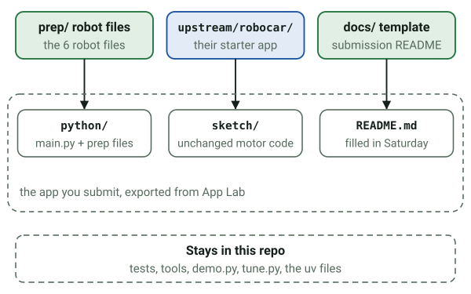
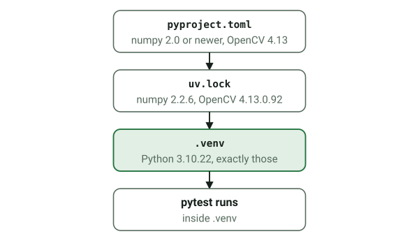

# Build Day prep: Robocar track

Prep for Build Day with Qualcomm (Saturday, Oct 24, 2026, Northeastern University Silicon Valley,
the venue; event page https://luma.com/2xsshzd3). The robot finds a ball, drives to it and
pushes it toward the goal. This repo holds the detector, the camera reader and the decision
logic, written and tested on a laptop before the robot exists, plus the notes and templates for
the day.

## How the robot works

The UNO Q holds two computers: your Python runs on its Linux side and picks each move, and the
microcontroller runs the motors and stops each move on time. Bridge carries the moves between them.


Every move is one short pulse decided from a fresh picture, and any doubt stops the run.


## Layout

### The repo root

| Path | What it is for |
|---|---|
| `README.md` | This file: what is here, what the organizers' files do, and the commands that matter. |
| `GAME_PLAN.html` | The Build Day game plan: the event, the robot, the rules, tonight's work and Saturday's steps, with every diagram. Open it in a browser; GitHub shows HTML as code. |
| `CLAUDE.md` | The rules for Claude sessions in this repo: Python 3.10, one OpenCV build per environment, the 1000 ms pulse cap, no em or en dashes. |
| `.gitignore` | Keeps `upstream/`, virtual environments, generated samples, recordings and trained models out of this repo's history. |
| `docs/` | Notes for you and the judges, listed below. |
| `figs/` | The diagrams as SVG files, each drawn once and shown in this README, the docs and the game plan page. |
| `prep/` | The code: a uv project on Python 3.10, listed below. |
| `upstream/` | The organizers' guide: a separate git clone, not part of this repo, explained below. |

### docs/

| File | What it is for |
|---|---|
| `NOTES.md` | The quick reference for Saturday: the kit, the setup order, how a run works, the driver API, the network and safety rules, the Mac notes, Python on the board, moving the code into the app, and the commands. |
| `CHECKLIST.md` | What to do before Saturday, the day's steps in order, and what to uninstall after the event. |
| `QUESTIONS.md` | The open questions for check-in, each with why it matters. |
| `RUBRIC_PLAN.md` | The judges' five criteria and how this build earns each one. |
| `CALIBRATION_LOG.md` | Empty tables to fill in on the day: pulses, camera timing, ball size and height, detector settings, and runs. |
| `SUBMISSION_README_TEMPLATE.md` | The README the judges get. Copy it into the app as `README.md` on Saturday and fill it in. |
| `EDGE_IMPULSE.md` | A practice run for training the ball and goal model, and how to use it on the day. |
| `SPEC.md` | The design: the constraints, the config file, each module, and the tests. |

### prep/

Robot files, which go into the app on the day if pre-written code is allowed:

- `detector.py` finds the ball and the goal by color and shape; `model_runner.py` runs a trained
  Edge Impulse model instead.
- `stream.py` reads the camera, keeping only the newest frame, and notices stalls.
- `controller.py` picks each move; `runloop.py` repeats look, decide, move.
- `robocar_config.json` holds every number.
- `robocar_main_template.py` is the guide's `main.py` wired to these; its contents become the
  app's `main.py`.



Laptop only, never on the robot:

- `demo.py` dry-runs the whole loop with pretend motors; `tune.py` tunes colors with sliders.
- `tools/`: a synthetic field video, a fake camera, and a stand-in Edge Impulse model.
- `detector_presets.json`: starting color ranges for `tune.py`.
- `notebooks/`: what the robot sees, step by step, with the pictures saved in. Open them in VS
  Code and pick the `prep/.venv` kernel.
- `tests/`, `pyproject.toml`, `uv.lock` and `.python-version`: the tests and the uv project.
- `requirements-board.txt`: exact pins for the board, used only if `import cv2` fails there.

## upstream/: the organizers' guide

A separate git clone of github.com/aaishikasb/uno-q-hackout, kept for reading. Your repo's
`.gitignore` leaves it out, so it is never committed or pushed here. Get it with
`git clone https://github.com/aaishikasb/uno-q-hackout upstream`, and refresh it with
`git -C upstream pull`. The guide has two tracks; only `robocar/` matters for this build.


| Path | What it is for |
|---|---|
| `README.md` | The two tracks and both rubrics. The Robocar rubric is the judges' scoring sheet. |
| `robocar/README.md` | The robocar guide: connect the robot, run the starter, open the camera stream, tune short moves, detect the ball, add a goal attempt. Then the code map, terminal commands, driver API, hardware and camera reference, and Edge Impulse training. |
| `robocar/PREWORK.md` | The 30-minute pre-work: what each of the board's two processors does, how they talk over Bridge, preparing your computer, and a walk through the starter. |
| `robocar/app.yaml` | The App Lab manifest: the app's name, description and icon, with no bricks and no ports. |
| `robocar/python/main.py` | The starter routine: a startup stop, health and sensor prints, then one 200 ms forward pulse per BOOT press. The prep template replaces it. |
| `robocar/python/robot_client.py` | The Python driver, `MiniAutoRobot`: `drive`, `stop`, `is_running`, `read_sensors`, `servo`, `buzz`, `led`, `drive_raw`, `health`, and `run_program`, which runs your routine once per BOOT press. Every call goes over Bridge. |
| `robocar/sketch/sketch.ino` | The microcontroller firmware: the mecanum wheel mixing, timed stops, the sensors, the BOOT button and its countdown, and the Bridge functions Python calls (`drive`, `drive_raw`, `stop`, `read_sensors`, `health`, `servo`, `buzz`, `led`). Keep it as supplied. |
| `robocar/sketch/sketch.yaml` | The sketch's build profile: the UNO Q's Zephyr platform and exact Arduino library versions, including `Arduino_RouterBridge` 0.4.2, which is Bridge itself. |
| `robocar/Makefile` | Terminal shortcuts that work over adb; see below. |
| `robocar/scripts/flash.sh` | What `make flash` runs on the board; see below. |
| `robocar/camera/HiwonderCamStream/HiwonderCamStream.ino` | The camera's firmware, flashed separately and already on the kits: its own Wi-Fi access point (at `192.168.5.1`, with a network name set per kit), the MJPEG stream at `:81/stream` with a preview page, and the BOOT button, offered to the UNO Q as I2C device `0x79`. |
| `arcade/` | The other track, a game console with a TFT screen and Modulino controls. Not used here. |
| `.gitignore` | Keeps their build output, ZIPs, `robocar/captures/` and `robocar/models/` out of their history. |

### What the guide's own docs leave out

- The `make` targets, run from a copy of `robocar/`: `package` zips `app.yaml`, `python/` and
  `sketch/` for App Lab; `build` compiles the sketch on the laptop (it needs `arduino-cli`);
  `flash` packages, pushes the ZIP to the board over adb and runs `flash.sh` there; `monitor`
  opens the microcontroller's serial console; `logs` follows the Python app's output; `stop`
  stops the app, which is not a motor-power cutoff; `devices` lists boards on adb; `clean`
  removes the ZIP and the sketch build. With several boards connected, add `SERIAL=...`.
- What `flash.sh` does on the board: it unzips the app into a temporary folder with Python's zip
  tool, checks for `app.yaml`, `python/main.py` and the sketch, stops the old app, replaces
  `$HOME/ArduinoApps/uno-q-robocar-cli/python` and `sketch` wholesale, and starts the app with
  `arduino-app-cli`. So anything changed by hand inside `python/` on the board is gone after the
  next flash, and the unzip drops execute bits; the model runner gives a model its bit back. It
  also refuses to replace an app folder it didn't create.
- `robot_client.py`: `drive()` checks the run state before and after each pulse, waits
  `ms / 1000 + 0.1` seconds, and raises `ProgramStopped` once BOOT has disabled the program.
  `run_program` has no guard around its own Bridge calls; the prep template adds one.
- Bridge calls give up after 10 seconds with a `TimeoutError` (Arduino's `bridge.py`).
- The sketch turns a speed of 0 to 255 into a percentage, then drives the wheels at that divided
  by √2 for straight moves and slides, and at half of it for turns in place. Speed 100 gives
  about 27% wheel power going straight and 19% turning; the prep's placeholder speeds give 24 to
  33%.
- Every camera's Wi-Fi uses channel 1, since the firmware sets no channel, so a room of robots
  shares one channel.
- Their `.gitignore` lists `robocar/models/`, while the guide's text puts the model in `python/`;
  this repo's notes use `python/models/robocar.eim`.

## Commands (from `prep/`)

```bash
uv run pytest
```

`uv run` makes `.venv` match the exact versions in `uv.lock` before it runs the command:



The board runs Python 3.13, so check that too; this builds a throwaway environment and leaves
`prep/.venv` on 3.10:

```bash
uv run --isolated --python 3.13 pytest
```

```bash
uv run python tools/make_synthetic_video.py
```

```bash
uv run python demo.py --source samples/synthetic_field.avi
```

```bash
uv run python demo.py --source 0 --show
```

```bash
uv run python tune.py --source samples/synthetic_field.avi --loop
```

`docs/NOTES.md` has the board commands, the fake camera, recording, and how to move the code into
the robot's app on the day.
