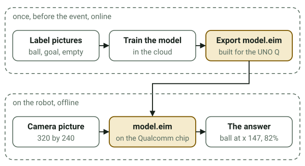

# Edge Impulse practice run

Goal: train one ball and goal detector before Saturday, so on the day the steps are familiar and
`model_runner.py` has a real model to run. About an hour, most of it waiting for training. It uses
the guide's settings (`upstream/robocar/README.md`, "Edge Impulse: train a detector") and the
organizers' August dataset: 321 pictures from the robot's own camera, labelled goal, robot and
soccer_ball.



## Steps

1. Make a free account at studio.edgeimpulse.com. This needs you; I can't create accounts.
2. Open the August dataset, studio.edgeimpulse.com/public/1085406/live, and click "Clone this
   project". Your copy has the labelled pictures, already split into training (255) and test
   (66).
3. Create impulse, with the guide's settings:
   - Image width 96, height 96, resize mode Squash.
   - Processing block: Image. Learning block: Object Detection (Images).
   - Save impulse.
4. Image (under Impulse design): color depth RGB, Save parameters, then Generate features.
5. Object detection: FOMO MobileNetV2 0.35, 150 to 180 training cycles, learning rate 0.001,
   training on CPU, data augmentation on. Save and train, then note the F1 score for each label.
6. Model testing: classify the test set and note the accuracy. This is the honest number, since
   the model never saw those pictures.
7. Deployment: choose Arduino UNO Q, build, and download the `.eim` file. Save it as
   `prep/models/robocar.eim`; `models/` is git-ignored, since the model comes from your own
   account. If Edge Impulse also offers a macOS build, download that too, as
   `prep/models/robocar-mac.eim`, to run it on the laptop.

## Trying it on the laptop

The runner needs an `.eim` built for the machine it runs on: the UNO Q build only runs on the
board. With a macOS build, point `model.path` at it in a copy of the config and run the demo with
the model. No `chmod` is needed: the runner gives a model back its run permission when an unzip
or a download has dropped it.

```bash
uv run python demo.py --source 0 --show --detector model --config my_config.json
```

The synthetic video's ball is drawn, not photographed, so a model trained on real pictures may
not find it. A real soccer ball in front of the webcam is the better test.

## On the day

- The guide's own project (studio.edgeimpulse.com/public/1144501/live) is meant to hold prelabelled
  captures; it was empty on Oct 22. Use it if it has data by then, or keep your copy of the
  August one.
- Add pictures from this robot's camera (`demo.py --record`), in separate sessions for training
  and for testing, label them, retrain, and deploy for Arduino UNO Q again.
- Copy the `.eim` into the app's `python/models/`, set `"detector": "model"` in the config's
  `run` section, and check the startup log. The labels can be `soccerball` (the guide) or
  `soccer_ball` (the August dataset); the config accepts both.
- FOMO reports where the ball is, not how big it looks, so the controller judges "near" and
  "close" by how low the ball sits in the picture as well. Calibrate `slow_y_frac` and
  `close_y_frac` (see `CALIBRATION_LOG.md`).
