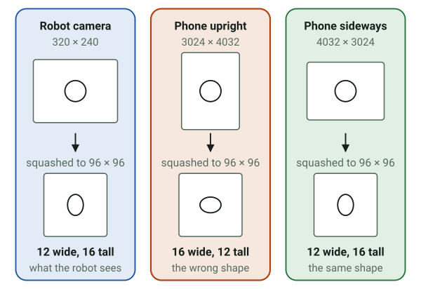

# Edge Impulse practice run

Goal: train one ball and goal detector before Saturday, so on the day the steps are familiar and
`model_runner.py` has a real model to run. About an hour, most of it waiting for training. It uses
the guide's settings (`upstream/robocar/README.md`, "Edge Impulse: train a detector") and the
organizers' August dataset: 321 pictures from the robot's own camera, labelled goal, robot and
soccer_ball.


## Steps

1. Make a free account at studio.edgeimpulse.com. This needs you; I can't create accounts.
2. Open the August dataset, studio.edgeimpulse.com/public/1085406/live, and click "Clone this
   project". Your copy has the labelled pictures, already split into training (255) and test
   (66).
3. Create impulse, with the guide's settings:
   - Image width 96, height 96, resize mode Squash.
   - Processing block: Image. Learning block: Object Detection (Images).
   - Save impulse.
4. Image (under Impulse design): color depth RGB, Save parameters, then Generate features.
5. Object detection: FOMO MobileNetV2 0.35, 150 to 180 training cycles, learning rate 0.001,
   training on CPU, data augmentation on. Save and train, then note the F1 score for each label.
6. Model testing: classify the test set and note the accuracy. This is the honest number, since
   the model never saw those pictures.
7. Deployment: choose Arduino UNO Q, build, and download the `.eim` file. Save it as
   `prep/models/robocar.eim`; `models/` is git-ignored, since the model comes from your own
   account. If Edge Impulse also offers a macOS build, download that too, as
   `prep/models/robocar-mac.eim`, to run it on the laptop.

## Trying it on the laptop

The runner needs an `.eim` built for the machine it runs on: the UNO Q build only runs on the
board. With a macOS build, point `model.path` at it in a copy of the config and run the demo with
the model. No `chmod` is needed: the runner gives a model back its run permission when an unzip
or a download has dropped it.

```bash
uv run python demo.py --source 0 --show --detector model --config my_config.json
```

The synthetic video's ball is drawn, not photographed, so a model trained on real pictures may
not find it. A real soccer ball in front of the webcam is the better test.

## On the day

An organizer's advice on Oct 24: the guide's project (studio.edgeimpulse.com/public/1144501/live)
now holds the organizers' own pictures, 321 of them labelled goal, robot and soccer_ball, the
same set as August's. They were taken in an office, so their colors and lighting won't match the
event room. A bigger set from the room is coming; until then, take your own pictures with your
phone, about 50 of the ball and 50 of the goals, draw the boxes by hand, and start with a small
model.


1. Sign in at studio.edgeimpulse.com, open the guide's project and click "Clone this project".
2. Data acquisition, "+ Add data", "Collect new data", "Scan QR code to connect to your phone".
   Take the pictures on the field, in the room's own light: about 50 with the ball, 50 with the
   goals (one picture can hold both), and about 10 of empty floor, which show the model what is
   not a ball. Vary the distance, and put the ball left, center and right.
3. Take them the way the robot sees: crouch, hold the phone at about the height of the robot's
   camera, and hold it sideways. Edge Impulse squashes every picture to 96 by 96, and the shape
   it squashes from matters, as the picture below shows.
4. Name the boxes with the labels the clone already has: `soccer_ball` and `goal`. A new
   `soccerball` label, the spelling in the guide's text, would split the ball into two classes
   that the model learns apart. The app accepts either spelling (`model.ball_labels`), but one
   model should use one.
5. Train with the settings in steps 3 to 5 above, deploy for Arduino UNO Q as in step 7, and
   download the `.eim`.
6. Copy it into the app as `python/models/robocar.eim`, set `"detector": "model"` in the
   config's `run` section, and read the startup log: it prints the model's labels, and warns if
   none of `ball_labels` is among them. Test in watch-only mode first.
7. Once the robot's camera works, add pictures from it (`demo.py --record`, then "Upload data"
   in Data acquisition), in separate sessions for training and for testing, and retrain. They
   match what the model sees on the robot better than any phone picture can.



The numbers come from drawing a round ball in a picture of each size and squashing it with
OpenCV's resize, the way Edge Impulse's Squash mode does. A model learns the shapes it is shown,
so pictures held upright teach it a ball the robot's camera never produces. The general idea has
a name: a gap between the pictures a model is trained on and the ones it meets later is called
domain shift, and the office pictures have it too, in color and light.

FOMO reports where the ball is, not how big it looks, so the controller judges "near" and
"close" by how low the ball sits in the picture as well. Calibrate `slow_y_frac` and
`close_y_frac` (see `CALIBRATION_LOG.md`).

### The guide's `edge-impulse-linux` line, and why this app skips it

Since Oct 24 the guide says to add `edge-impulse-linux` to the app's `python/requirements.txt`
while the board still has Internet, for the package's `ImageImpulseRunner`. This app doesn't
need it, because `model_runner.py` already does the same job, message for message. Both start
the model with a socket path, send `{"hello": 1}` and then `{"classify": [...]}` with a matching
`id`, read each reply up to its closing zero byte, and check its `success` field (compared with
the package's source, version 1.2.2). The package also has a shared-memory path, which it takes
only when the model offers one.

Adding it would be safe. Its other dependencies (PyAudio 0.2.14, six, numpy) are already in the
app's container, which sees the system's packages, and App Lab installs `requirements.txt` only
when the file changes. It would still add a download to an app that never calls it. If the real
model ever fails with `model_runner.py`, the board can rejoin the hotspot over USB and install
the package then, to compare the two.

The guide also mentions App Lab's Video Object Detection brick, which signs in to Edge Impulse
from App Lab. This app doesn't use it: it reads the robot's camera stream itself and runs the
model through `model_runner.py`.
