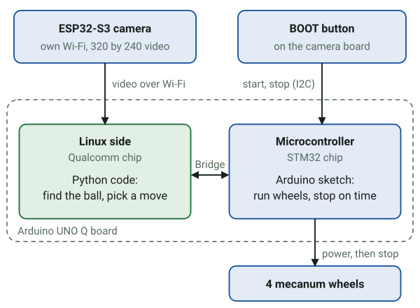
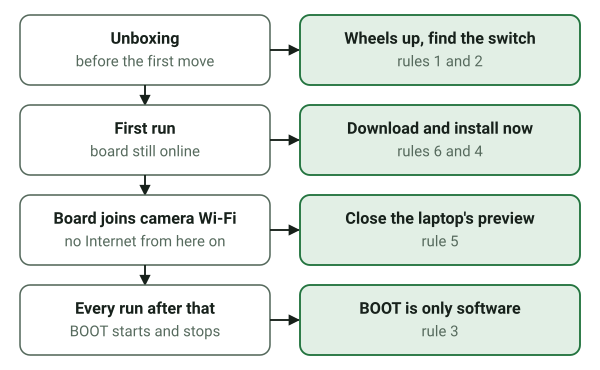

# Build Day notes

Written before the event as the quick reference for the day, then kept on Oct 24 as the day's
time-stamped log, which has its own section below. The reference parts condense the event guide,
github.com/aaishikasb/uno-q-hackout (its `README.md` and `robocar/README.md`, read at commit
`8f40c4e` and rechecked at `1fc4493` of Oct 22, which adds `robocar/PREWORK.md`), Arduino's App Lab
source (app-bricks-py at `bricks/0.13.1`), and the organizers' August event, the Robot Soccer Cup.
The event page is https://luma.com/2xsshzd3.

## The kit



- An Arduino UNO Q on a Hiwonder miniAuto chassis, preassembled. Its mecanum wheels can drive,
  slide sideways and turn in place.
- An ESP32-S3 camera (GC2145 sensor) with its own Wi-Fi network and no Internet. It streams
  320 × 240 MJPEG at `http://192.168.5.1:81/stream`, with a preview page at
  `http://192.168.5.1:81/`. The network name is unique per robot,
  and the password comes with the robot.
- An ultrasonic distance sensor (I2C `0x77`), a four-channel line sensor (`0x78`), and the
  camera's BOOT button, read over I2C (`0x79`).
- The starter covers the motors (`sketch/sketch.ino`) and the camera firmware. You write the
  detector and the decision logic in `python/`.
- This kit (Oct 24): its camera's network on Wi-Fi channel 1
  like the 9 other teams' cameras in range. The board also carries the organizers' August app,
  "Qualcomm/AI-LA Robot Soccer Cup" (500 ms moves, RED and BLUE teams switched by a 5 s BOOT
  hold); leave it stopped.
- `battery_mv` reads about 1.5 times too high on the UNO Q. The sketch's factor (29.89 mV per
  step on A3) was set for the original Arduino, which measures against 5 V; the UNO Q measures
  against 3.3 V. With the board switch on, it read about 11,270, which works out to about 7.4 V.
  With the board switch off it reads about 1,315, because the pack isn't connected to the pin.
- On the camera's Wi-Fi the board is `192.168.5.2`. The app holds the camera's one stream, so a
  second viewer waits until the app stops. A 6-second recording at 1:55 PM had 21 frames, about
  3.5 a second at 13 to 14 KB each, far below the 15 the prep assumed; the crowded channel 1 is
  the likely cause. The app restarted fine there with no Internet. At 2:06 PM a second recording
  had only 5 frames in 6 seconds, and pings to the camera took 21 to 288 ms, so the rate swings
  with the room's Wi-Fi. NetworkManager leaves Wi-Fi power saving at its default on this
  connection; turning it off (`802-11-wireless.powersave 2`) is the cheap thing to try first.
- After the app stops, the camera keeps its one stream busy for a few seconds, so a second viewer
  can time out if it connects at once; it works a few seconds later.

## The day's log, Oct 24

- 2:06 PM: the cone-goal code (midpoint of two cones, yellow cone colors, ball floor 170) is on the
  board. From 2:07 the app fails at start: its first Bridge call, `stop`, times out after 10 s,
  so the motor chip (MCU) isn't answering, and the serial monitor (`arduino-app-cli monitor`)
  gets no reply to `health` either. It started right after the camera was tilted by hand, and
  the Python changes can't cause it: the failing call comes before any detector code runs. The
  sketch talks to the camera's button and the sensors over I2C in `setup()` and every `loop()`,
  so a disturbed camera cable that holds the I2C bus would stall it. Power saving off made the
  fastest ping 2 ms instead of 21 ms; the busy channel still spikes to 200 ms.
- Power-cycling the board switch at 2:15 didn't help: the camera came back and the board rejoined
  it by itself, but the chip still didn't answer. Every app start does reset the chip
  (`flash_sketch.cfg`: reset, check the flash, reset again), and the sketch compiles fine offline.
  The starts that worked (1:55 and 1:58 PM) each put a burst of
  "invalid packet" lines in the router log, the sketch's start-up text arriving on the RPC
  serial line; the failing starts put none, so nothing reaches the router from the chip at all.
  Next test: a board restart, which also restarts the router; if the chip still says nothing,
  suspect the I2C wiring and ask the organizers.
- 2:21 PM: `sudo reboot` fixed it. The router's log showed the chip's start-up text again, the app
  started with `bridge: True`, and the distance and line sensors answered for the first time
  today (516 mm, `line_ok` true). The battery number fell to about 6,500 from about 11,300
  before 2:00, so check the pack with a meter. A watch-only run (BOOT pressed) averaged about
  5 frames a second but had gaps of up to 1.5 s, which the 400 ms `stale_after_ms` treats as a
  dead camera.
- 2:36 PM: `stale_after_ms` went to 1500 and `read_timeout_s` to 2.0 (the reader must outwait the
  limit, or it reconnects first). Then a plain `app stop` and `app start` left the chip silent
  again, with no "invalid packet" burst in the router log, while the restart after `sudo reboot`
  had worked. So on this board an app restart can leave the chip silent and only a board restart
  is sure to bring it back: put new files on the board, then reboot it, then start the app.
- About 2:40 PM: the camera was tilted so the far edge of the carpet sits about 30% of the way down
  the picture. With nothing in front of it, the model found nothing in three live pictures: no
  false alarm on the carpet, the windows or another robot.
- 2:44 PM: after `sudo reboot` the app started with the model (`observe, model detector`). The
  battery number keeps falling with no motor running: about 11,300 at 2:00, 6,500 at 2:21, 5,529
  at 2:44. A fresh pack read about 11,550.
- After the battery swap the camera restarted, but the board kept its old Wi-Fi link: `nmcli`
  said connected while the camera's address stayed `INCOMPLETE` in `ip neigh` and the app logged
  "No route to host". `nmcli con up "SSID"` (it works over adb without sudo) brought the
  video back at once, about 7 frames a second. Run it after anything that restarts the camera.
- 2:55 PM, first watch-only run with the model (ball about 1 m ahead, two cones about 2 m away
  with a phone-length gap): 73 new frames in 21.7 s, and the ball was found in every one, at
  x=140 or 150 and y=130; the move each time was "forward speed=110 ms=200: ball centered and
  far: approach". The goal was never found: the training pictures show the cones from above, as
  round discs, while the robot sees them from the side and small at 2 m. The video still stalled
  for 1.5 s or more about every 5 s: the other 13 checks said "no new frame for" 1540 to 1785 ms.
- 2:57 PM: `stale_after_ms` went to 3000 and `read_timeout_s` to 4.0, to ride out stalls of about
  2 s every 5 s; the reader must still outwait the limit.
- 2:58 PM, the fast way: `arduino-app-cli app stop` then `arduino-app-cli app start --no-prepare`.
  It skips the preparing step (compiling the sketch and resetting the chip through openocd), the
  chip keeps running, and the app came up with `bridge: True`. Use it for settings and Python
  changes; only a changed sketch needs the full start.
- 2:59 PM, first attempt-mode run, wheels raised: 13 moves in 14.3 s, each from a fresh picture:
  6 "forward speed=110 ms=200: ball centered and far", 1 "forward speed=90 ms=150: ball centered
  and near", and 6 "right speed=120 ms=86: ball 30 px right of center (band 24): slide toward
  it". The second BOOT press ended the run ("program stopped"). Moves came 0.5 to 2.5 s apart,
  set by the video rate.
- 3:00 to 3:03 PM, the first four floor runs (attempt mode, the model, the ball ahead and two
  cones behind it). Two ended at 0.2 s with "ball lost for 2 frames in a row", before any move.
  The third saw a ball far off to the right (x=210, y=50), slid right twice, then lost it and
  ended at 1.5 s; the pictures below show another team's ball far off, which may be what it saw.
  The fourth drove toward the ball for 9.4 s: six forward moves (speed 110, 200 ms), one slide
  right, then a slow approach as the ball got near (y from 110 to 160). It was still going when
  the app was stopped at 3:03 to grab pictures, which cut it off, so check the log for a run in
  progress before stopping the app. Those pictures show the ball about 20 cm ahead, where that
  run had brought the robot, and the model found it there (confidence 1.0). The likely cause of
  the instant stops is the BOOT press itself: the button is on the camera, so the hand pressing it
  can fill the first pictures, and `miss_frames_to_end` 2 ends the run on the first two.
- 3:13 PM: `miss_frames_to_end` went to 5, so a run holds still through up to 4 missed pictures
  and ends on the fifth. The app restarted with `--no-prepare` and came up with `bridge: True`.
  In the fourth run above, the ball stayed at y=130 across two forward moves, so a 200 ms move at
  speed 110 may barely move the robot on this carpet (the model's positions come in 10 px steps,
  so a small move can also hide in one step).
- 3:20 PM, the first full attempt (miss limit 5, the ball 50 cm to 1 m ahead, the cones behind
  it): done in 14.7 s. The first picture held a ball far off to the right (x=250, y=70),
  probably another team's, and the robot slid right toward it; from the second picture on it saw
  this ball, centered. Five forward moves (speed 110, 200 ms) and one slow one brought the ball
  from y=130 to y=210, then came three pushes (speed 160, 350 ms), each "goal not in view:
  pushing as if lined up", and the attempt finished after the third with the ball rolled on to
  y=150. The ball stayed at y=210 through the first two pushes, so they moved the robot and the
  ball together. Pictures came about 2.2 a second, so a move came every 1.5 to 2 s. The ball
  stopped short of the cones: the run ended on its own push limit (`max_pushes` 3), not on a
  failure.
- 3:21 to 3:27 PM, three more runs (miss limit 5, 3 pushes, 30 s). One reached the ball, pushed
  twice, and the ball rolled off to the left; four slides left never re-centered it (it stayed at
  x=70, then 50), so slides barely move the robot on this carpet; it ended "ball gone after 2
  push(es)" at 22.1 s. One slid right toward a far ball (x=270, y=50) and then saw nothing,
  ending at 2.1 s. One pushed three times and finished at 14.7 s, the ball rolled ahead and left.
  Balls far away near the top of the picture (other teams', y=30 to 90) pulled the robot
  sideways in 4 of the last 5 runs.
- 3:28 PM: `max_pushes` went to 8 and `run_time_limit_s` to 45. This time the `--no-prepare`
  restart failed: "Request 'stop' timed out after 10s", the motor chip silent again, though the
  run before it had ended normally. `sudo reboot` is the known fix.
- 3:32 PM: after `sudo reboot` the board rejoined the camera's network by itself (camera address
  REACHABLE), and a full `app start` came up with `bridge: True` and the new settings. The app
  log keeps the earlier failed start above the new one, so read the newest "App is starting"
  block and its time before deciding a start failed.
- 3:32 to 3:36 PM, six lined-up runs with 8 pushes and 45 s. The best two pushed 4 times each:
  one followed the ball for 18 s until BOOT stopped it, and the other pushed, drove up again
  after the ball rolled ahead, pushed three more times, and ended "ball gone after 4 push(es)" at
  23.2 s. Two pushed twice and lost the ball (at 7.3 s and 31.3 s); two ended in the first 3 s, with no ball in
  view or the ball close and off to the left. No run used more than 4 pushes. The ball kept
  settling about 30 px left of center, just outside the 24 px band, and up to 8 slides in a row
  (speed 120, 86 ms) never re-centered it: sideways slides don't move the robot on this carpet.
  One of these runs put the ball between the cones (seen at the field; the log can't show
  which, since the robot never saw the cones).
- 3:45 PM: submitted. At 2:59 the organizers named the hand-in: one pull request to
  github.com/aaishikasb/uno-q-hackout-submissions adding only
  `10-24-neu/robocar-track/<github-username>.zip`, with the submission details in the ZIP's
  `app.yaml` description, before 4:00 PM. The ZIP was built from the board's app folder
  (`app.yaml`, `README.md`, `python/` with the model, `sketch/`; no `.cache`), 4.2 MB, and the
  pull request is github.com/aaishikasb/uno-q-hackout-submissions/pull/8. The ZIP was not
  test-imported into App Lab. The model file carries the Edge Impulse username.
- 3:49 PM, the ZIP checked: the copy in the pull request is byte-identical to the one built, and
  its 13 files match the board's running app. `arduino-app-cli app import` accepted it ("Import
  successful", app ID `user:atharv-girish-chaudhary`) into a scratch folder (`HOME=/tmp/importhome`
  keeps it out of App Lab's real app list), and `app details` read every description field. In
  a throwaway container from the app's image, all its Python compiled, its settings loaded
  (attempt, model, 8 pushes, 45 s, 5 misses), and its model found the ball, the goal between two
  cones and nothing on empty floor, in 3 to 8 ms. Not tried: starting the imported app, which
  would stop the demo app and reset the motor chip.
- 4:00 PM, why the goal was never seen, checked on the 3:03 recording (both cones in plain view,
  about 30 px wide and 110 px apart). The model returned the ball and no cone box at all, and
  this `.eim` reports no thresholds, so its cut-off can't be lowered. After its resize the cones
  are about 12 px wide, like the training cones, so size is not the cause; the training pictures
  show them from above, as round deep-yellow discs. The color range missed for another reason:
  it was set from the organizers' pictures (cone saturation 245) and accepts 200 and up, while
  this camera shows the cones at saturation 80 to 108 (hue 24 to 30, brightness 112 to 240). The
  ball stays below saturation 52. A range of hue 20 to 36, saturation 65 to 255, brightness 100
  to 255 found the goal in all 29 frames with the cones in view and in none of the other 76. With
  `"detector": "model"` the color finder never runs: `runloop.py` hands the model both the ball
  and the goal. The color ball finder found this ball in 28 of 29 frames, but it only searches the
  bottom 43% of the picture, so it sees the ball only once it is within about 1 m.
- A seventh 8-push run, just before 4:00: 4 pushes, two slides toward a far ball (x=250, y=50),
  then the ball rolled left and 12 slides in a row over 15 s left it at x=70 to 90, until it was
  lost ("ball gone after 4 push(es)" at 36.7 s). The clearest sign yet that slides don't move the
  robot on this carpet.
- 4:06 PM: `steer_mode` went to rotate (turn toward the ball, `rotate_speed` 160, 80 to 220 ms)
  and `center_band_px` to 40, in one restart; `--no-prepare` worked this time (`bridge: True`).
  Turning has never been tried on the floor, so the first run checks that a turn moves the ball
  toward the middle of the picture. Two tests and the second notebook had the slide directions
  written in; they now follow `steer_mode`.
- 4:11 PM: the first run after that stopped at once, "camera feed problem: no frame yet
  (OSError: [Errno 113] No route to host)". The camera's network was gone from
  the board's Wi-Fi scan (other robots' cameras showed up), the battery read 5,380 (a fresh pack
  reads about 11,550), and the board had fallen back to a phone hotspot saved on it, so
  `nmcli con up "SSID"` failed. The camera runs on the robot's battery, so a flat pack
  takes the video with it. The app itself kept running, with the motor chip answering.
- 4:16 PM: with a charged battery in, the camera's network showed up in the first scan,
  `nmcli con up "SSID"` moved the board back from the hotspot, the camera answered
  pings (2 to 4 ms, none lost), and inside the app's container the video reader had a live
  connection to 192.168.5.1:81 again, without an app restart.
- 4:23 PM: BOOT presses did nothing: no run started in the log. Asked directly over Bridge, the
  motor chip answered (`battery_mv` 11,029 with the new pack) but said `program_enabled` false and
  `line_ok` false. The BOOT button and the line sensor both reach the chip over I2C from parts
  powered by the robot's battery, so the flat pack seems to have left the chip's I2C link dead
  while the chip itself, powered over USB, kept running. A full `app start` (which resets the
  chip) at 4:24 left the chip silent ("Request 'stop' timed out"), as at 2:36, so it needs
  `sudo reboot`.
- 4:26 PM: after `sudo reboot` the board joined the camera's network by itself, and a full
  `app start` came up with `bridge: True` and `battery_mv` 10,909. But `line_ok` stayed false;
  it was true at 3:32 and even at 4:06 on the flat pack. The sketch reads the camera's BOOT button
  over the same I2C wiring (address 0x79, two bytes: press count and hold state), so a loose
  cable after the battery swap would explain both. The test is a BOOT press: the robot's lights
  show red, then yellow, then green when the chip hears it.
- 4:29 PM: a BOOT press did nothing, and no run started in the log, so the chip's I2C read of the
  button fails (`readCamButtonState` gives up when fewer than 2 bytes come back). The idle light
  is a check anyone can see: while waiting for BOOT the sketch blinks the front ultrasonic
  sensor's lights blue every 1.5 s, also over I2C, so no blinking means the I2C wiring is off.
  Since the line sensor still answered at 4:06 on the flat pack and stopped after the swap, a
  cable knocked loose during the battery swap is the likeliest cause.
- 4:32 PM, a stopgap for the judge: the board's `robot_client.py` (the guide's file, patched on the
  board only; no copy of the patch was kept) now also counts a run as enabled while a file
  `python/go` exists, and deletes the file when the run ends, so a run can start from the laptop
  (`touch` over adb). Loading it with a `--no-prepare` restart left the chip silent, so
  the board was rebooted once more and fully started at 4:34 (`bridge: True`, battery 11,328), and
  this time `line_ok` was true again. A laptop-started run at 4:34 stopped at 0.6 s with no ball in
  view. Then a run started by BOOT (so the button works again) drove to the ball, pushed 4 times,
  turned toward balls with `rotate_left` and `rotate_right`, and ended "ball gone after 4
  push(es)" at 18.4 s.
- 4:37 PM, a ball-only run started from the laptop (no cones): 4 forward moves (speed 110,
  200 ms) left the ball at y=150 every time, so they barely moved the robot; then y went 170, 190,
  210 over 2 slow moves, 2 pushes followed, and after the second push the ball vanished from the
  picture and the run ended "ball gone after 2 push(es)" at 12.9 s. Where it went decides the
  fix: off to a side is outside the model's view (it sees only the middle 240 of 320 columns),
  and right against the robot is below the camera's view.
  It was the second: after the second push the ball stayed against the robot, in the blind spot
  below the bottom of the picture, and the rule "ball gone after a push means finished" ended the
  run. A caution on the forward moves: the model's positions come in 10 px steps, and far away a
  few centimeters change the picture by less than that, so y=150 four times does not prove the
  robot stood still; the approach is slow mostly because a move comes only every 1.5 s.
- About 4:45 PM: presented to the judge with the robot ready. Standing: first in the Robocar
  track so far, not confirmed yet, since other teams are trying their runs again.
- Just before 4:50 PM, the retry runs. The first was the best run of the day: 6 forward moves and
  a slow one to the ball, then all 8 pushes between 10.0 and 22.2 s, keeping the ball against
  the front of the robot; twice the ball dropped into the blind spot for 2 pictures and came back,
  so the miss limit of 5 carried it through. It ended "attempt finished after 8 pushes" at 23.1 s.
  The second was stopped with BOOT after 4 forward moves, at about 5 s.
- 4:51 PM: about 4x the distance per move, turning unchanged: approach 110 for 200 ms to 220 for
  400 ms, slow 90 for 150 ms to 180 for 300 ms, push 160 for 350 ms to 255 (the top) for 550 ms.
  The `--no-prepare` restart worked (`bridge: True`, `line_ok` true, battery 10,939). Motor speed
  alone could not go 4x, since speeds stop at 255; the robot also looks slow because a move comes
  only every 1.5 s, waiting for fresh pictures.
- The first run with the faster moves: the ball started near (y=170), so only the near and push
  moves ran, at their new sizes. Each big move made the ball drop out of view for 2 pictures (the
  robot jumped into it, into the blind spot or past it), it pushed twice at 255 for 550 ms, and
  after a second near move the ball stayed lost: "ball gone after 2 push(es)" at 10.8 s. The best
  run at the old speeds kept the ball in front for all 8 pushes, so near the ball the big moves
  cost control.
- About 4:57 PM: first in the Robocar track, with a 7.12 s run, as reported at the field. The
  robot still had the faster moves from 4:51 (approach 220 for 400 ms, slow 180 for 300 ms, push
  255 for 550 ms); nothing changed after them. The board was unplugged from the laptop, so that
  run's log was not read.
- About 5:05 PM, the judged runs read from the app's log, which survived the board's power-off.
  After the first fast run there were two more: one stopped with BOOT after 2 far moves, and the
  last, most likely the judged one: 2 far moves (220 for 400 ms), a near move, pushes at 4.4 s
  and 5.9 s, then 2 near moves after the ball as it rolled off to the right, until it left the
  picture at 10.4 s ("ball gone after 2 push(es)" at 10.9 s). A goal at 7.12 s fits between the
  second push and the ball leaving the picture; the log can't show the goal itself.
- Before handing the kit back: the app stopped, the guide's `robot_client.py` put back (same
  checksum as the copy saved before the change), and the model file removed from the board
  (identical to the local copy, so nothing was lost). The board still holds the saved
  Wi-Fi profiles (the camera's, a phone hotspot and another saved network) and this app
  without its model.
- 5:07 PM: the phone hotspot profile deleted from the board (with sudo). The app
  stays on the board, as do the camera's profile and another saved network (not ours, so left).
- 5:09 PM: the board shut down with `sudo poweroff` before unplugging, and the kit went back to
  the organizers. Photos and videos of the robot exist for the write-up. The organizers are
  announcing the results.
- Result, announced at the close: first place in the Robocar track. The prizes were an Arduino
  UNO Q (4 GB) and a LEGO race car.


## Setup, in order

1. Raise the wheels off the table, find the motor-power disconnect, and keep it within reach.
2. Plug the UNO Q in with a USB-C cable that carries data, and set it up in App Lab as its board
   guide describes.
3. Collect the camera's Wi-Fi name and password, and the robot's motor calibration, from the
   organizers. Find the BOOT button on the camera.
4. While the board still has Internet, run the starter once: import the prepared ZIP in App Lab
   (My Apps, then import), or `make flash` from a copy of `robocar/`. The first run downloads and
   compiles the sketch's Arduino libraries. Press BOOT: one 200 ms forward pulse, then a stop.
5. On the laptop, join the camera's Wi-Fi and open the preview page. Try the ball at several distances
   and to each side, and settle the camera's angle. Then close the page, since the camera serves
   only one viewer.
6. On the board, join the camera's Wi-Fi from its Linux side, with USB still connected:
   `adb shell`, then `sudo nmcli device wifi connect "SSID" password "PASS"`. The board saves the
   network and rejoins it after a reboot; `nmcli device wifi list` shows what is in range.
7. Check the stream from the app with the snippet in step 3 of the robocar guide.

## How a run works

- The app starts with the robot still, and prints the board's health and sensors.
- A short BOOT press starts a red, yellow, green countdown of about 1.2 seconds, then enables the
  program. `run_program` runs your routine once per press.
- `robot.stop()` stops the motors and ends the run; another BOOT press starts the next one.
  Pressing BOOT during a run disables the program, and the next `drive()` raises
  `ProgramStopped`, which `run_program` catches and reports.
- `robot.drive("stop", speed=0, ms=100)` stops the motors but keeps the run going.
- Keep the starter's `robot.run_program(...)`, its startup `robot.stop()` and its `finally`
  block; they provide this lifecycle.
- Holding BOOT for five seconds flips `hold_toggle`, which the track does not use.

## Driver API (`python/robot_client.py`)

| Call | What it does |
|---|---|
| `drive(direction, speed=150, ms=500)` | One timed move. Needs an enabled program, waits `ms / 1000 + 0.1` s, then checks the run state again |
| `stop()` | Stops the motors, turns obstacle avoidance off, and ends the run |
| `is_running()` | Reads `program_enabled`. Check it in any loop that doesn't call `drive()` |
| `read_sensors()` | JSON: `ultrasonic_mm` and `ultrasonic_cm` (`-1` means unknown), `battery_mv`, line bits, `program_enabled` |
| `drive_raw(m0, m1, m2, m3, ms=500)` | Sets each motor directly and returns at once, without the wait |
| `health()`, `led(on)`, `buzz()`, `servo(angle)` | Board identity, lights, beeper, and the gripper if fitted |

- Directions: `forward`, `backward`, `left` and `right` (sideways slides), `rotate_left`,
  `rotate_right`, `stop`. An unknown name makes no move and reports no error.
- Limits in the firmware: speed 0 to 255, raw motor values -255 to 255, duration 0 to 5000 ms.
  Duration 0 means continuous motion.
- At the same speed number, turning in place drives the wheels at about 70% of the power of a
  straight drive or a slide, because the sketch halves the wheel mix whenever rotation is
  involved. That is why `rotate_speed` (160) is higher than `strafe_speed` (120).
- Bridge calls give up after 10 seconds by default and raise `TimeoutError` (Arduino's
  `bridge.py`).

## The six rules on the day

Six rules from the guide, three for safety and three for the network, each placed at the moment
it matters. The two sections below give the details.



## Network rules

- Install any Python packages on the UNO Q before it joins the camera's Wi-Fi: that network has
  no Internet. This build needs none (see below), but the rule holds for anything you add.
- The first run of an app needs Internet, to download and compile the sketch's libraries.
- The camera serves one stream at a time: close the browser preview, or stop the board's app,
  before another reader connects.
- Keep USB connected while the board is on the camera's Wi-Fi; App Lab talks to it over USB.
- The laptop has no Internet while it is on the camera's Wi-Fi, so the web goes offline
  during previews, recordings and tuning. A phone hotspot over USB keeps the Mac online.

## On the Mac

- macOS asks before an app talks to devices on the local network, such as the camera at
  `192.168.5.1`. Allow it for Warp and the browser (System Settings, Privacy & Security, Local
  Network); without it, `demo.py` and `tune.py` fail with "No route to host".
- An `.eim` built for the board is a Linux ARM program and won't run on the Mac; laptop tests need
  a macOS build (`EDGE_IMPULSE.md`).
- uv, Python 3.10, OpenCV's window build and the guide's Makefile all work on this Mac (checked
  Oct 22).
- VS Code opens `prep/` as its folder. On Oct 24 at 12:49 its Ruff extension rewrote 23 files in
  `prep/` (Ruff's fixes plus its formatter at 88 characters, and VS Code's JSON layout), and Ruff
  and Pylance listed 207 warnings, none of them a bug. `prep/.vscode/settings.json` turns Ruff and
  Pylance's type checking off for this folder and stops formatting on save; reload the VS Code
  window for it to take effect. The rewrite itself was undone at 1:20 PM.

## Safety rules

- Duration 0 means "drive forever". Every pulse in the prep code is 1 to 1000 ms, enforced when
  the config loads and again before each move of a run.
- BOOT is a software stop, and blocking firmware routines can delay it. The motor-power
  disconnect is the real stop.
- Never rely on a Python `finally` as the only stop: if the process dies it never runs. The
  firmware's timed stop at the end of each pulse is the backstop.
- `stop` or `x` in the serial monitor stops the motors but does not end the Python program,
  which can send another move.
- The serial motor tests (`1` to `4`, `dir_sweep`, `dir_scan`, `combo_scan`, `pwm_combo`) move the
  wheels and some freeze the main loop: supervised and with the wheels raised only.
- Never turn on the old obstacle demo (`F|1|&`): a failed distance reading makes it drive forward.
- Only one App Lab app runs at a time.

## Python on the board (verified in Arduino's source)

- App Lab runs the app's Python in a container built on `python:3.13-slim-trixie` (Debian 13).
  numpy and Arduino's own build of `opencv-python-headless` 4.13 are already installed, and the
  image pins that exact OpenCV build through `UV_CONSTRAINT`.
- `python/requirements.txt` is installed with `uv pip install` into `/app/.cache/.venv`, and only
  when the file changes. A failed install is retried at every start, and the app starts anyway.
- So this build ships no `requirements.txt`. Listing `opencv-python-headless` there breaks the
  install on images up to `bricks/0.13.1` (Sep 29); Arduino fixed it on Sep 30 (PR 458). The
  template prints the Python, numpy and OpenCV versions at startup, which settles it.
- Checked on Oct 23: App Lab 0.11.0 came out that day, and the PR 458 fix is still only in a
  prerelease (`bricks/0.14.0rc1`, Oct 15), so the rule above stands. If App Lab offers to update
  the board's software at the event, ask the organizers first.
- Seen on Oct 24: the board update (arduino-app-cli 0.14.0, arduino-router 0.11.0, kernel 7.0.0)
  ended with "Update failed" while it streamed its log, and its cleanup removed the running app.
  A restart (`sudo reboot` in App Lab's board shell) finished it, the new kernel came up, and the
  app had to be started again. The app's container is still `python-apps-base:0.13.1`, so the
  rule above stands.
- After that restart App Lab offered one more update, the MCU core `arduino:zephyr` 1.0.0
  (released Sep 2) over the board's 0.90.0. The core is the kit App Lab builds the motor sketch
  with; 0.90.0 built the guide's sketch and runs it. 1.0.0 moves to Zephyr 4.4, so installing it
  means a rebuilt motor sketch: redo the BOOT test and the 1000 ms stop test afterwards, and ask
  the organizers first. Skipped at 12:30; the board stayed on 0.90.0 and the app kept running.
- The guide's pull request #1, merged on Oct 24, adds two more ways to run an Edge Impulse
  model: `edge-impulse-linux` in `requirements.txt`, and App Lab's Video Object Detection brick.
  The prep's model runner needs neither; `EDGE_IMPULSE.md` says why.
- If `import cv2` does fail on Saturday, `prep/requirements-board.txt` has exact pins with Linux
  ARM wheels for Python 3.10 to 3.13 (checked with `uv pip compile --python-platform
  aarch64-unknown-linux-gnu`). Add them while the board still has Internet.
- If an error escapes `App.run`'s loop, App Lab shuts the app down and BOOT does nothing until it
  is restarted. The prep loop catches every error, stops the motors and returns, and the
  template's `user_loop()` also catches errors from `run_program`'s own Bridge calls, such as a
  timeout while waiting for BOOT.
- The container sits on its own Docker network. If the camera answers from `adb shell` but not
  from the app, run `ip route` on the board and check that the camera's subnet is not hidden.

Offline wheels were not built, because this build needs no Python downloads. If a board ever
lacks OpenCV and the venue has no Internet, this downloads the Python 3.13 set (about 55 MB) on
the laptop; reference it in `requirements.txt` with `--no-index` and
`--find-links /app/python/wheels` (an absolute path, since relative ones depend on uv's version):

```bash
uvx pip download numpy==2.2.6 opencv-python-headless==4.13.0.92 -d wheels --only-binary=:all: --implementation cp --python-version 3.13 --abi cp313 --platform manylinux_2_28_aarch64 --platform manylinux2014_aarch64
```

## Moving the prep code into the app

1. In your own copy of the robocar app (an imported ZIP in App Lab, or a copy of
   `upstream/robocar/` outside `upstream/`), put these files in `python/` beside `main.py`:
   `detector.py`, `model_runner.py`, `stream.py`, `controller.py`, `runloop.py`,
   `robocar_config.json`, and `models/robocar.eim` if you use a trained model.
2. Replace `main.py` with the contents of `prep/robocar_main_template.py`.
3. Don't add a `requirements.txt` (see above).
4. Start with `"mode": "observe"` in the config's `run` section, so the robot only watches and
   prints, then switch to `"attempt"`.

## Watching a run from the laptop

Keep the USB-C cable in while the robot runs: App Lab's log view, or `make logs` from a copy of
`robocar/`, shows each decision line as it happens, with what the camera saw and why the robot
moved. The laptop can't watch the video during a run, because the camera serves one viewer and
the robot is using it; record with `demo.py --record` while the board's app is stopped instead.

## Laptop commands (from `prep/`)

```bash
uv run pytest
```

```bash
uv run python tools/make_synthetic_video.py
```

```bash
uv run python demo.py --source samples/synthetic_field.avi
```

```bash
uv run python demo.py --source 0 --show
```

```bash
uv run python tools/fake_camera.py --source samples/synthetic_field.avi --loop
```

```bash
uv run python demo.py --source http://127.0.0.1:8081/stream
```

```bash
uv run python tune.py --source samples/synthetic_field.avi --loop
```

On the day, with the laptop on the camera's Wi-Fi and the board's app stopped, record real
footage for tuning and replay:

```bash
uv run python demo.py --source http://192.168.5.1:81/stream --mode observe --record recordings/run1
```

## Board commands (from a copy of `robocar/`)

| Command | What it does |
|---|---|
| `make devices` | List connected boards |
| `make flash` | Copy the app to the board, compile and upload the sketch, start Python |
| `make logs` | Show the app's Python output as it comes, `print()` lines and errors included (Ctrl+C leaves the app running) |
| `make monitor` | The MCU serial monitor at 9600 baud |
| `make stop` | Stop this app (not a motor-power cutoff) |
| `make package` | Build `build/uno-q-robocar.zip` for App Lab import |

With several boards connected, add `SERIAL=...` from `make devices`. If another app is running:
`adb -d shell`, then `TMPDIR=/tmp arduino-app-cli app list` and `TMPDIR=/tmp arduino-app-cli app
stop APP_ID`. Your Mac's built-in `make` (GNU Make 3.81) runs this Makefile; tested on Oct 22.

## What the August event tells us

- Field: green floor, dark walls with red tape on one side and blue on the other, a small white
  goal with a net against an end wall, and a black and white soccer ball. Source: the organizers'
  public Edge Impulse dataset of 321 onboard-camera images, and their earlier repo.
- Its teams found the ball and goal with Edge Impulse models (FOMO, and in one case YOLO-Pro), and
  used HSV color only to tell the red side from the blue side.
- One team found that plain `cv2.VideoCapture` lagged by "tens of seconds" because old frames
  piled up; a background thread that keeps only the newest frame fixed it. `stream.py` does the
  same.
